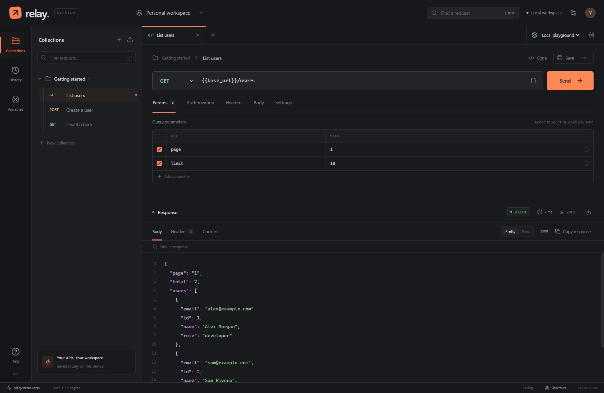

# Relay

A Postman-style desktop workspace for HTTP APIs. A Rust backend sends requests and stores your workspace; React and TypeScript provide the interface inside Tauri 2.



## Run on this computer

Double-click `Start Relay.cmd` in this folder, or use the **Relay API Client** desktop shortcut. A bundled Windows development build is already available at `target/debug/relay.exe` on this computer. Its installer is `target/debug/bundle/nsis/Relay_0.1.0_x64-setup.exe`.

To run the source with live reloading, open PowerShell and run:

```powershell
cd C:\Studies\Testing\ReaTesting
npm.cmd run desktop
```

The first launch compiles the Rust dependencies. Later launches reuse them. The launcher finds Rust in your profile even if your terminal has an older PATH. For a fresh checkout, run `npm.cmd ci` first.

Windows prerequisites are Node.js, stable Rust with `x86_64-pc-windows-msvc`, Visual Studio C++ Build Tools with a Windows SDK, and Microsoft Edge WebView2. These are installed on this computer.

## Try it

1. Keep **Local playground** selected in the top-right environment picker.
2. Open **Getting started → List users** and click **Send**.
3. Open **Create a user**, edit the JSON in **Body**, and send it. The local API echoes your request.
4. Change the URL to `{{base_url}}/status/404` or `{{base_url}}/delay/3` to try an error status or cancellation.
5. For your own API, create a request and enter an `http://` or `https://` URL.

The built-in demo service binds only to `127.0.0.1` on an available port. Its `base_url` refreshes when Relay starts. No account or external demo service is required.

## Features

- GET, POST, PUT, PATCH, DELETE, HEAD, OPTIONS over HTTP/HTTPS.
- Multiple request tabs, query parameters and headers, raw JSON/text bodies.
- Bearer tokens, HTTP Basic authentication, environment variables in request fields.
- Rust execution with cancellation, timeouts, optional redirects, SSL verification, decompression, and a session cookie jar.
- JSON highlighting, raw view, response search, headers, Set-Cookie inspection, timing, size, copy, and download.
- Collections, saved requests, request history, dark/light themes, keyboard shortcuts.
- Postman Collection v2/v2.1 import/export, including folders, disabled rows, raw bodies, and supported inherited auth. Imported collection variables create a separate selected environment.
- Atomic workspace persistence. Response bodies are not stored in history.

## Build a Windows executable and installer

```powershell
npm.cmd run desktop:build
```

- `target/release/relay.exe` — desktop executable.
- `target/release/bundle/nsis/` — Windows setup executable.

For a quicker development executable without an installer:

```powershell
npm.cmd run desktop:build -- --debug --no-bundle
```

Output: `target/debug/relay.exe`. A built executable includes the frontend and needs no Vite server or open terminal. WebView2 must remain installed.

`npm.cmd run dev` provides only a browser preview at `http://127.0.0.1:1420`. Use `npm.cmd run desktop` for Rust HTTP requests.

## Checks

```powershell
npm.cmd run build
npm.cmd test
npm.cmd run test:rust
npm.cmd run check:rust
npm.cmd run test:e2e
```

Rust integration tests use a real controlled loopback HTTP server. Browser tests use a mocked Tauri bridge to exercise editing, collections, import/export, cancellation UI, persistence, and shortcuts. They complement native application testing. Browser tests use installed Google Chrome.

The Rust test command uses one compiler job to avoid concurrent Windows linker operations. This affects build scheduling, not test coverage or application request concurrency.

To repeat the native checks, start Relay with `WEBVIEW2_ADDITIONAL_BROWSER_ARGUMENTS=--remote-debugging-port=9223` and `RELAY_DATA_DIR` set to a disposable test directory, then run `npm.cmd run test:native`. Keep the debugging port restricted to local development. The script supports both the development WebView and the bundled executable.

## Data and practical limits

Workspace data is stored in `%APPDATA%\dev.relay.api\workspace.json`. Malformed or unsupported data is reported and left intact. `RELAY_DATA_DIR` optionally selects a separate workspace directory for isolated development/testing.

Requests, credentials, and environment values are saved as **plain text**, including credentials in history. Exports can contain secrets. Relay is a personal workspace, not a credential vault. Cookies are shared between requests in the current app session and are not persisted.

Responses are capped at 10 MiB and marked when incomplete. Binary responses show a hex preview of the first 4096 bytes; binary file download is not supported. The viewer renders up to 6000 lines; text download includes the captured body. History retains 80 entries; workspace JSON is limited to 8 MiB. Timeouts range from 100 to 600,000 ms.

This first release supports HTTP workflows. It does not include Postman cloud/team services, OAuth login flows, scripts/tests, multipart uploads, WebSocket, or gRPC. Unsupported imported body/auth modes produce explicit errors rather than silently changing requests. cURL snippets use POSIX quoting; use Git Bash on Windows.

## Architecture

- `crates/relay-core`: Rust HTTP engine, cancellation, storage, demo service.
- `src-tauri`: Tauri commands and Windows integration.
- `src`: React interface, request model, variables, Postman compatibility.
- `e2e`: browser workflow tests.
- `docs/research.md`: scope and evidence from the Postman artifact inspected with REA.

Relay is an independent implementation with its own name, design, and code.
